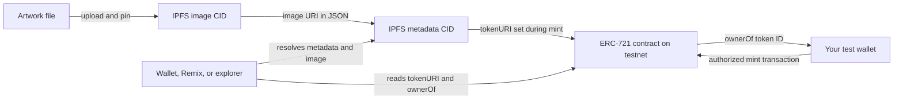

# TokenizeArt: 2-Week Beginner Study and Project Plan

**Time available:** 14 days, about 3–4 hours per day (42–56 hours total)  
**Starting point:** New to blockchain, smart contracts, and NFTs  
**Target:** Complete and understand the mandatory requirements in `en.subject.pdf`, then submit a repository that is easy to review.

## What the assignment asks you to build

TokenizeArt is a small end-to-end Web3 project. You will create one digital artwork containing a correctly displayed **42**, store that image on distributed storage such as IPFS, deploy a standards-based NFT smart contract to a **test network**, mint an NFT with the required metadata, and explain how to use and inspect it.

The reviewer should be able to find:

- `README.md` at the repository root, explaining your platform and implementation choices.
- `code/` with readable, commented smart-contract source.
- A deployment folder (the subject calls this `deployment/`) with the deployment files/scripts and instructions.
- `mint/` with the files or instructions needed to mint.
- `documentation/` explaining how the NFT works and how to use/verify it.
- The public contract address and network after deployment, plus a way to display the NFT and confirm its owner (for example, `ownerOf`).
- NFT metadata where the **artist is your 42 login** and the **name includes “42” and a title**.
- An image containing a clearly legible “42”, hosted on IPFS or equivalent distributed storage.

The subject says not to use real money: use a test chain and test tokens. The minting website, especially beautiful artwork, on-chain image/metadata inscriptions, and demo video are optional. Bonus work is only evaluated after every mandatory requirement works.

## Recommended beginner route

Use **Solidity + OpenZeppelin ERC-721 + Remix + BNB Smart Chain Testnet**, since the subject itself introduces BNB Chain and BNB testnet tokens. Keep the contract small: one NFT, a clear owner/admin rule, and a safe mint function. Use Remix for the first deployment if that is the least setup; if your evaluators expect submitted deployment scripts, add the simplest scripts/tooling you can explain and reproduce. Record your exact tool and network versions in the README.

Before relying on a specific testnet, faucet, wallet flow, or explorer, check its current official documentation. These services can change. Never share or commit your wallet seed phrase or private key. Use a fresh test wallet and only test funds.

## Daily rhythm

For each study day, aim for:

- **45–75 min:** Read or watch the listed concept resources.
- **90–120 min:** Apply the concept to your own project.
- **30–45 min:** Write notes, update documentation, and check that you can explain what you did.

If a topic takes longer, protect the mandatory deliverables: skip the optional frontend, elaborate artwork, and bonus features first.

## Day-by-day plan

| Day | Learn (about 1 hour) | Build (about 1.5–2 hours) | End-of-day result |
|---|---|---|---|
| **1 — Understand the brief and Web3 basics** | Read this plan and the assignment. Learn what a blockchain, wallet, address, transaction, gas, testnet, and NFT are. | Make a checklist of the required files and decide on a simple artwork concept with a visible 42. Choose the BNB Chain testnet route. | A one-page project checklist, chosen network/tool route, and sketch/concept. Explain in your own words what is on-chain and what will be stored on IPFS. |
| **2 — Wallets, networks, and safety** | Learn public/private keys, wallet addresses, signing, transaction fees, and why testnets exist. Read the current official BNB Chain testnet guide. | Create or designate a fresh test wallet. Add the test network using official instructions. Find its current faucet and block explorer. Do not put secrets in the repository. | Wallet can view the chosen test network; you know how to get test tokens and inspect an address/transaction. Add a local-only `.env.example` later, never a real secret. |
| **3 — NFT and ERC-721 foundations** | Learn fungible vs non-fungible tokens, token IDs, ERC-721, `ownerOf`, `tokenURI`, and events. | Read the OpenZeppelin ERC-721 guide and contract API. Sketch the smallest contract interface needed for one token. | A short design note: who may mint, what token ID is used, how ownership is checked, and how metadata is linked. |
| **4 — Solidity essentials** | Learn contract/state/function/visibility, constructor, `require`, address types, and basic events. | Work through the Solidity by Example storage and token examples or Remix Solidity intro. Write a tiny practice contract in Remix; do not deploy the final NFT yet. | You can explain each line of your practice contract and the difference between read-only calls and transactions. |
| **5 — ERC-721 contract, first draft** | Study OpenZeppelin’s ERC721 and ERC721URIStorage (or current recommended equivalent). Understand inheritance and safe minting. | In `code/`, write a minimal contract with a clear name/symbol and a restricted mint function. Add readable comments and explicit names. Avoid extra roles/features unless necessary. | Contract draft compiles in Remix. You can explain how mint authorization works and why a random wallet cannot mint if minting is restricted. |
| **6 — Contract review and test deployment rehearsal** | Learn compiler version, ABI, bytecode, deployment, transactions, and common revert errors. | Compile with the version required by the source. Deploy to Remix VM/local test environment first. Try allowed and disallowed mint calls; inspect `ownerOf` and `tokenURI`. | A working rehearsal, a short list of expected checks, and no unexplained compiler warnings/errors. |
| **7 — Create the artwork** | Review image formats and dimensions appropriate for a small digital artwork. The image can be simple; legibility of “42” matters. | Create the NFT image with a clearly readable 42. Save the original in the repository in a sensible asset location. Check that the image displays correctly. | Final image chosen; the number 42 is clearly visible and not distorted. Record creator/asset details for metadata. |
| **8 — Metadata and IPFS** | Learn the JSON metadata fields `name`, `description`, `image`, and `attributes`, and how an IPFS CID identifies content. | Create metadata JSON. Make the name include “42” and a title; set artist/creator to your exact 42 login. Upload the image and metadata using a reputable IPFS pinning/storage service or a local IPFS workflow. Save the resulting URI/CID. | Image and metadata have durable-looking `ipfs://` URIs (and gateway URLs for browser checking). Open them and verify the image and JSON resolve. |
| **9 — Connect contract to metadata** | Review `tokenURI` behavior and the exact metadata URI format supported by your chosen wallet/marketplace. | Update the contract/deployment inputs so the token receives the metadata URI at mint time. Recompile and rehearse deployment and minting. | You can describe the chain link: token ID → `tokenURI` → metadata JSON → IPFS image. |
| **10 — Deploy to testnet** | Read current official deployment instructions for Remix or your chosen deployment tool and current BNB testnet explorer. | Deploy the final contract to the testnet using only test funds. Save the contract address, transaction hash, network name/chain ID, compiler version, and deployment date. | Verified deployment transaction and public contract address; address opens on the correct explorer. |
| **11 — Mint and verify ownership** | Learn how to call a contract function through Remix/explorer, and how to read `ownerOf` and `tokenURI`. | Mint the NFT to your test wallet. Call `ownerOf(tokenId)` and compare it with the recipient address. Check `tokenURI` and resolve the metadata/image. | One minted NFT on testnet; owner and metadata URI verified; record token ID and transaction hash. |
| **12 — Reproducibility and repository structure** | Review what a reviewer needs to reproduce the deployment and mint. | Populate `deployment/` and `mint/` with concise instructions and required scripts/configuration. Add `.env.example` if needed, with placeholders only. Make sure no private keys, seed phrases, or real secrets are tracked. | Another beginner can follow the deployment and mint instructions without guessing. |
| **13 — Documentation and README** | Review the assignment’s file/folder checklist and explain the project in plain language. | Write root `README.md` with choices/reasons, requirements, network and contract address, links, setup/deploy/mint/verify steps, and limitations. Write `documentation/` with architecture, metadata fields, security/ownership rules, and how to display/check the NFT. | All required folders and docs exist; commands/links/addresses are consistent. |
| **14 — Final acceptance pass and presentation practice** | Revisit anything you cannot yet explain. Practice a 3–5 minute walkthrough. | Follow your own README from a clean terminal/browser session as far as possible. Check image, metadata, network, contract, mint, `ownerOf`, folder names, and repository status. Fix gaps. | Complete mandatory checklist below, concise demo path, and a short list of known limitations. Skip bonus work unless every required item passes. |

## Must-pass checklist

- [ ] Artwork contains a clearly legible **42**.
- [ ] Artwork is accessible via IPFS or another distributed registry; metadata points to it.
- [ ] Metadata name includes **42** and a title; artist is your exact 42 login.
- [ ] Contract follows the chosen chain’s NFT standard (for the recommended route: ERC-721 on an EVM chain).
- [ ] Contract source is in root `code/`, readable and commented.
- [ ] Deployment files/instructions are in a root `deployment/` folder.
- [ ] Mint files/instructions are in a root `mint/` folder.
- [ ] Root `README.md` explains the choices and reasons.
- [ ] Root `documentation/` explains how the NFT works and how to use it.
- [ ] Contract is deployed and NFT minted on a public **test** blockchain; public address and network are recorded.
- [ ] You can show the NFT and verify its owner with `ownerOf` or an equivalent explorer/tool.
- [ ] You can explain mint permissions and the basic security choices in a code review.
- [ ] No real funds are needed; no wallet secret is committed.

## Simple architecture

Keep the project as a few pieces with explicit links between them. Only the contract and its ownership state live on the blockchain; the artwork and JSON metadata live in distributed storage, and the contract stores or returns the metadata URI.

Suggested repository responsibilities:

| Location | Put here | Keep out |
|---|---|---|
| `code/` | Contract source, comments, and any small contract-focused notes | Private keys, unrelated app code |
| `deployment/` | Reproducible deploy instructions/scripts, compiler/tool versions, network configuration template | Real credentials or hidden assumptions about a developer machine |
| `mint/` | Mint instructions/script, token ID/address/network record, metadata URI | Seed phrases or private keys |
| `documentation/` | Architecture, metadata example, security/permission explanation, verification walkthrough | Claims that were not actually checked |
| Root `README.md` | Project choices, prerequisites, exact steps, links, deployed testnet details | Secrets or vague instructions such as “deploy the contract” without steps |

For this scope, use one contract and one mint path. A website is unnecessary: Remix and a block explorer can demonstrate the required behavior. Store network name and chain ID together to reduce the chance of interacting with the wrong chain.

## Architecture and implementation best practices

- **Keep the contract small.** Implement only the required NFT behavior. Avoid marketplace functions, royalties, upgradeability, custom role frameworks, and a minting website unless the mandatory path already works and the extra feature is explicitly needed.
- **Use a standard implementation.** Build on the current compatible OpenZeppelin ERC-721 implementation rather than writing token ownership, transfer, approval, or receiver logic yourself. Pin/document the OpenZeppelin and compiler versions you used.
- **Choose the simplest metadata approach.** Set a metadata URI at mint time. For one token, a token URI passed to a safe mint function is easier to reason about than a general-purpose mutable metadata system. Do not add URI update powers unless required; if you do, explain who can use them and when.
- **Make mint permissions obvious.** State whether only the deployer/contract owner can mint or whether anyone can mint. For a single assignment NFT, one restricted mint is easy to demonstrate. Avoid “owner” ambiguity by naming the role clearly and documenting how it is set.
- **Separate content from references.** Upload and pin the image first, then create metadata JSON that points to its `ipfs://` URI, then upload/pin that JSON. Put the metadata URI in the NFT. Do not put a temporary gateway URL into the JSON when an IPFS URI is appropriate.
- **Keep deployment reproducible.** Record compiler version, library version, network name, chain ID, deployer address (public address only), contract address, transaction hash, token ID, and metadata URI. Keep secrets local and provide placeholder config only.
- **Make claims verifiable.** Link to the testnet explorer transaction/contract and state exactly how to call `ownerOf(tokenId)` and `tokenURI(tokenId)`. An explorer display may be delayed or lack metadata support, so also demonstrate the URI and contract reads directly.
- **Document limits honestly.** IPFS is content-addressed, but availability depends on keeping content pinned. A testnet NFT is a learning artifact and does not establish copyright or guarantee permanent marketplace display.

## Common errors to anticipate

| Symptom | Likely cause | What to check or do |
|---|---|---|
| Contract will not compile | Solidity pragma/compiler mismatch, incompatible OpenZeppelin version, typo in import path, or copied code targeting another library release | Match the compiler to the `pragma`; use docs/examples for the same OpenZeppelin major version; read the first compiler error before changing multiple things. |
| `Ownable` constructor error | OpenZeppelin version expects an initial owner constructor argument | Check the imported version’s API and pass the intended deployer/owner as required. Do not copy constructor syntax from a different version. |
| Transaction says insufficient funds | Wallet is on the wrong network, has no test token, or the selected account is different | Check network name and chain ID in the wallet and Remix; fund only with the official testnet faucet. |
| Transaction is pending or disappears | RPC congestion, wallet switched networks, low testnet fee, or explorer delay | Check the transaction hash on the correct chain’s explorer; avoid repeatedly submitting the same action before understanding its state. |
| Mint reverts with an authorization error | Connected account is not the authorized minter/owner, or the contract’s permission rule is wrong | Compare the active account to the contract owner; test both allowed and forbidden callers on the local VM before redeploying. |
| “Token already minted” or invalid token error | The chosen token ID has already been used, or `ownerOf` is being called before mint | Confirm the token ID and mint event; remember that `ownerOf` reverts for a nonexistent token. |
| NFT exists but image/metadata is blank | Wrong token URI, malformed JSON, missing `image` field, wrong CID/path, or content not pinned | Read `tokenURI` from the deployed contract; open the metadata JSON; then open its image URI; check spelling, JSON syntax, and pin status at each step. |
| Metadata works through a gateway but not `ipfs://` | The viewer handles URI schemes differently or is slow to index | Preserve and document the canonical `ipfs://` URI, test a gateway URL separately, and show direct contract/JSON evidence. Do not change the on-chain URI blindly. |
| Source verification does not match deployed contract | Wrong network/address or different compiler, optimization, or library settings | Confirm the exact deployed address/network and match compiler settings when verifying source. |
| Documentation address points to no contract | Copied wrong address or mixed testnet/mainnet details | Copy address from the successful deployment transaction and include network name/chain ID beside it; test every link. |
| Works in Remix VM but fails on testnet | VM account, network, constructor inputs, gas, or deployed code differs | Recheck the selected wallet account/network, deployment inputs, compiler settings, and transaction receipt; record the exact final deployment. |

## Security practices for this project

This is a learning project, but use safe habits from the start:

- Use a **fresh test wallet** with no valuable assets. A testnet protects funds from real-value loss, but careless signing can still expose secrets or confuse accounts.
- Never share or commit a seed phrase, private key, wallet export, API token, or provider secret. Do not paste one into chat, screenshots, README files, or source control. If one is exposed, treat it as compromised and replace it.
- Use the official chain documentation for network/RPC/faucet links. Be suspicious of sponsored search results, unsolicited wallet support, and “claim” links asking for a seed phrase.
- Read transaction details before signing: network, target contract, function, token URI/recipient, and requested permissions. Do not sign unknown messages or approvals just to make a demo work.
- Restrict minting intentionally. If the contract should only mint once, enforce that in contract state, rather than relying on a README or a promise not to call the function again. Test repeated mint attempts.
- Use OpenZeppelin’s safe minting method so contracts receiving an NFT can reject tokens they cannot handle. Do not implement ERC-721 transfer/approval internals yourself.
- Keep admin powers minimal. Avoid owner-controlled arbitrary transfers, unlimited minting, upgradeability, pausing, and metadata replacement unless the assignment needs them. Every extra privilege needs a clear reason and a test.
- Treat uploaded metadata/image as public and effectively immutable once referenced by a minted NFT. Do not upload personal or confidential information. Keep local source copies and pin the content.
- Do not claim IPFS guarantees permanent storage. Check pinning/availability and include both the CID/URI and a gateway link for practical review.
- Before submitting, inspect tracked files for `.env`, wallet files, seed phrases, private keys, and API credentials. If a secret was committed, removing the latest copy is not enough: rotate/revoke it and clean repository history as appropriate.
- Deploy only to the intended test network. Confirm chain ID in wallet and deployment tool before signing; do not reuse the testnet deployment instructions with mainnet funds.

### Minimum contract checks before testnet deployment

- [ ] Correct account can mint the intended token.
- [ ] A disallowed account cannot mint.
- [ ] The token cannot be minted twice if only one token is intended.
- [ ] `ownerOf(tokenId)` returns the expected recipient after mint.
- [ ] `tokenURI(tokenId)` returns the exact metadata URI that was uploaded.
- [ ] A nonexistent token ID causes the expected read failure; it does not return a misleading owner.
- [ ] You can explain every privileged function and who can call it.
- [ ] No upgrade, withdrawal, arbitrary transfer, or metadata-edit capability exists without a documented requirement.

## Good beginner resources

Prefer official documentation for setup details because network names, tools, and faucets may change. Use tutorials for concepts, then verify commands against the current official docs.

### Blockchain and BNB Chain

- [BNB Chain documentation](https://docs.bnbchain.org/) — official network, development, and testnet information.
- [BNB Chain testnet documentation](https://docs.bnbchain.org/bnb-smart-chain/developers/wallet-configuration/) — official wallet/network setup entry point; follow current links for testnet and faucet details.
- [Ethereum.org: What is Ethereum?](https://ethereum.org/en/what-is-ethereum/) — accessible overview of EVM chains and smart contracts; concepts apply to BNB Smart Chain as an EVM-compatible network.

### Solidity and smart contracts

- [Solidity: Introduction to Smart Contracts](https://docs.soliditylang.org/en/latest/introduction-to-smart-contracts.html) — official introduction; read the examples selectively.
- [Solidity by Example](https://solidity-by-example.org/) — short examples for syntax and contract behavior.
- [Remix IDE documentation](https://remix-ide.readthedocs.io/en/latest/) — browser IDE, compiling, deploying, and interacting with contracts.
- [OpenZeppelin Contracts: ERC-721](https://docs.openzeppelin.com/contracts/5.x/erc721) — standard ERC-721 implementation and concepts. Check the version against the import/compiler version you use.
- [OpenZeppelin Contracts Wizard](https://wizard.openzeppelin.com/) — optional way to generate a standards-based starter contract; read and understand the generated source before using it.

### NFTs, metadata, and IPFS

- [OpenSea: Metadata Standards](https://docs.opensea.io/docs/metadata-standards) — practical description of common NFT JSON metadata fields; marketplace guidance, not a chain standard.
- [IPFS Docs: What is IPFS?](https://docs.ipfs.tech/concepts/what-is-ipfs/) — content addressing and CIDs.
- [IPFS Docs: Pinning](https://docs.ipfs.tech/concepts/persistence/) — why content needs persistence/pinning to remain available.
- [Pinata documentation](https://docs.pinata.cloud/) — one IPFS pinning provider’s upload workflow; other providers are also possible.

## Scope advice

Aim for one NFT with one image and one token ID. Do not begin a minting website, on-chain image inscription, marketplace integration, or complex permission system while a mandatory item is unfinished. If time gets tight, use a simple original image, Remix for interaction, and direct explorer/contract calls for proof. The project is successful when the required path works and you can explain it—not when it has the most features.

